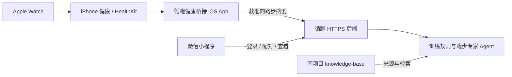

# Apple Watch 自动同步与跑步专家 Agent

更新：2026-10-10。当前自动同步的后端和 iOS 源工程已提供，本机没有 Xcode/iPhone 环境，尚未完成 Swift 编译、签名安装和真实 HealthKit 数据验证。DeepSeek 密钥也尚未配置。

## 数据为什么需要 iOS 伴随端

微信小程序没有本项目可用的原生 HealthKit 调用接口。微信运动只返回步数，不能作为 Apple 健康跑步记录的替代。

HealthKit 在 iOS App 中进行权限请求与读取。用户首次确认后，App 可以使用观察查询接收变化，再按锚点读取新增和删除的跑步记录。后台唤醒由 iOS 调度，不能承诺即时同步；Apple 明确要求后台投递在真机验证。



HealthKit 权限不能由小程序代替用户确认，也不能静默授予。“自动”指授权并配对完成后响应健康数据变化。

## 本轮实现

- 小程序“我的 → 连接 Apple Watch / Apple 健康”显示状态与最近同步回执，可生成配对码和撤销连接。
- 配对码8位、5分钟有效、一次使用。iOS端得到只可写跑步摘要的独立凭据；凭据不能读取账户、聊天或别人数据。
- 按 HealthKit UUID 增量更新，重发不会增加重复活动；更新保留你补填的 RPE 和比赛标记。
- HealthKit删除事件只删除相应用户的授权同步记录，不删除手动记录和文件导入。
- iOS端只在服务端确认后保存查询锚点。断网时保留原锚点，后续可重发；同一任务合并重复同步请求。
- iOS凭据与查询锚点放在设备 Keychain；后端只保存凭据哈希。撤销或过期后同步凭据失效，伴随端收到401后停止自动同步。
- 当前只读跑步、距离与可选平均心率，不读GPS、诊疗、体重、HRV或睡眠；后两者后续需独立实现与授权。

## 你需要准备的实际环境

1. 可使用 Xcode 的 Mac，以及你的 iPhone；将已生成的 `integrations/apple-health-ios/XunrunHealthBridge.xcodeproj` 复制到 Mac 打开。
2. 在 Xcode 设置自己的签名 Team 和唯一 Bundle ID，核实 HealthKit 与 Background Delivery 能力及签名权限。构建安装到 iPhone。该工程要求 iOS17+；签名能力以账户和Xcode实际结果为准。
3. 准备真实小程序 AppID、AppSecret、HTTPS后端与合法请求域名。电脑本机的127.0.0.1不能被iPhone直接当成同一台服务器。
4. 后端 `.env` 配置 `AUTH_MODE=wechat`、身份密钥和 `PUBLIC_BASE_URL=https://你的后端`；公网部署监听地址按部署环境设置。客户端设置 `mode:'api'`、`apiAuthMode:'wechat'` 与相同 HTTPS 服务地址。
5. 在小程序生成配对码，在伴随App填写服务地址和配对码，然后点击“申请Apple健康读取权限并启用同步”。首轮读取最近90天的跑步，后续增量同步。

如果没有 Mac，源码仍可交由可信的 Mac/Xcode 环境构建；在伴随端安装之前，当前可用路线为 Apple 健康导出文件 → 本地转换 → 小程序导入。文件导入不应标为自动同步。

## 真机验收

核对一次真实跑步的距离、时长、心率和日期；检查不同意读取、选择性读取、无数据、离线重试、重复回传、健康中删除活动、停止本机同步、小程序撤销连接与重新配对。HealthKit授权请求返回成功不等于用户授予了全部读取权限；查询为空时不得声称已经读取成功。

当前日期归属统一为 UTC+8。运动时长使用训练计时时长，心率只使用与该跑步关联的样本；缺失心率不补零。当前没有临床或实际比赛预测验证。

## 后台知识库与专家对话

已读取同项目“搭建 library 知识库”的稳定导出，并接入其 `exports/knowledge-cards.json`、`exports/sources.json`、`exports/retrieval-chunks-v1.jsonl`。原库原文件保留，项目只做适配。

来源库包含11本书、2946页索引、34张概括卡、12篇补充文献；与7张内置卡合并为41张来源概括卡。本机后台检索加载4908个有效片段、涉及2822个有足够文本的页位。2946是原库页级覆盖，不意味着每页图表都完整可检索。所有人类审校状态保留为尚未记录。

- 小程序知识页与Agent读取同一后端；快速检索也使用扩展卡。
- 默认检索概括卡。原书OCR片段需选择本地原书检索，保留机器未审校标记。
- 模型只接收概括卡、用户选择的当前问题/最近对话和单独授权的训练摘要；此前纯本地原书检索轮次不自动传给模型。
- 模型具有本地检索、训练摘要、恢复规则、等效成绩四个只读工具，不能改写账户或训练计划。
- 多来源引用保留PDF页序号、论文链接、来源查阅层级、条件与局限。不同文件指纹的Daniels版本不会共用原有来源ID。
- 真实微信部署默认不自动公开本地私有书库。个人受控试用若需要接入，应按实际部署与来源许可显式设置 `PRIVATE_LIBRARY_ACCESS=true`；公开分发和全书内容许可仍需单独确认。

## DeepSeek 配置

官方文档对应 V4.1 Flash 的模型名为 `deepseek-flash`。在服务器 `.env` 填写：

```dotenv
DEEPSEEK_API_KEY=your-deepseek-api-key
DEEPSEEK_MODEL=deepseek-flash
DEEPSEEK_BASE_URL=https://api.deepseek.com
PROJECT_KNOWLEDGE_DIRECTORY=../knowledge-base
```

填好后重启后端，在知识助手内选择“使用DeepSeek解释”。未配置、调用失败或引用无效时有明确的本地检索状态；不会伪称模型已成功回复。真实API调用按该账户计费；当前测试用模拟服务验证格式与工具，不含真实付费请求。

密钥只填服务器环境；不要放入小程序、源代码、知识库或对话输入框。知识库的本地索引没有嵌入API依赖，改换模型供应商不需要重做书籍OCR。

## 官方依据

- [Apple HealthKit授权](https://developer.apple.com/documentation/healthkit/authorizing-access-to-health-data)
- [HKObserverQuery](https://developer.apple.com/documentation/healthkit/hkobserverquery)
- [HKAnchoredObjectQuery](https://developer.apple.com/documentation/healthkit/hkanchoredobjectquery)
- [HealthKit后台投递](https://developer.apple.com/documentation/healthkit/hkhealthstore/enablebackgrounddelivery(for:frequency:withcompletion:))
- [DeepSeek模型更新说明](https://api-docs.deepseek.com/updates/)

已核查HealthKit观察/增量查询与后台投递官方文档；仍需真机完成实际授权与数据读取验证。