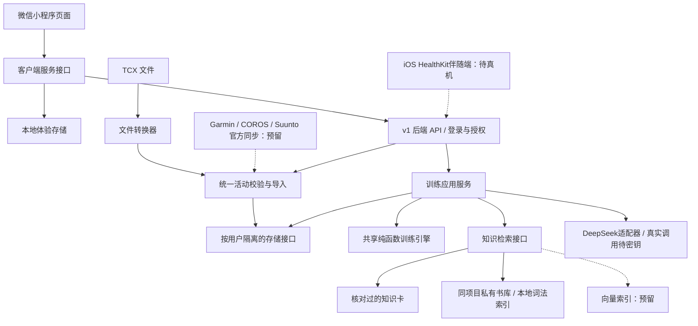

# 架构与后期扩展

采用模块化单体：原生微信小程序 + Node.js HTTP API + SQLite。先建立清楚的模块边界，减少试用期部署成本。未来用户量、后台任务或时序数据增长后再拆服务，不预先引入微服务集群。

本轮实际状态以 [INTEGRATION-STATUS.md](INTEGRATION-STATUS.md) 为准：同项目知识库与DeepSeek适配器已接入；Apple HealthKit桥接的后端和iOS源工程已提供，设备端仍需编译安装。下面早期架构中的“预留”不表示本轮所有接口仍未实现。

实线为当前实现，虚线为尚未连接的扩展。

## 目录边界

| 目录 | 职责 | 禁止混入 |
| --- | --- | --- |
| miniprogram/pages | 展示、表单、交互 | 设备密码、模型密钥、训练公式 |
| miniprogram/services | 客户端调用、本地体验/后端切换 | 在请求失败时自动回退并混用示例 |
| miniprogram/domain | 单位、输入校验、VDOT、状态与基础计划纯函数 | wx API、数据库、外部网络 |
| miniprogram/data | 知识卡、候选书目、设备能力描述 | 原书完整文本与密钥 |
| server/services | 编排规则、数据和知识解释 | 某个厂商特有字段 |
| server/adapters | 微信、设备、知识/模型供应商适配 | 修改训练规则来适配设备 |
| server/repository.mjs | 持久化与用户隔离 | 全局共享某个用户的活动 |
| server/migrations | 有版本的数据库升级 | 直接改生产表且无迁移记录 |
| contracts | 跨模块数据与端口定义 | UI 样式或供应商 SDK 实现 |
| scripts | 本地数据转换、私有知识提取、检查 | 未经授权的后台全文上传 |

## 新增设备

1. 在 adapters 中实现 ActivityProvider 的授权、撤权、拉取与游标接口。当前设备类仅为明确报“未接入”的占位，并没有假的成功响应。
2. 所有设备输出 ImportBatch v1：km、秒、日期（UTC+8 的运动开始日）、running、来源、稳定 externalId。原始厂商指标应放在独立扩展表/时序存储，不能改核心字段语义。
3. 同一用户/provider/externalId 保证幂等。跨设备合并是后续独立决策，需要时间与距离容差及人工纠错。
4. OAuth token 只放后端并加密保存。未来加入连接表、同步任务表、webhook 事件 ID、重试、撤权删除和回调 state 校验；当前没有开放未实现的 OAuth 回调入口。
5. UI 按 capability/status 显示可用功能。加新适配器不需要改训练引擎。

当前日期统一 UTC+8，适合本轮试用。支持国际用户时增加带 IANA 时区的 startedAt/timezone 字段，并迁移旧日期；不要默默更改旧数据所属日。

## 新增训练策略与预测模型

训练计算与接口/页面分开。当前共享 engine.js 是可验证基线，未来按状态评估、能力模型、训练计划分别拆纯函数模块；切换策略要保留 modelVersion。

新增策略先比较现有基线，记录输入、输出、适用人群、版本与引用。正式保存长期计划时增加 plan_versions、assessment_snapshots 与来源快照，使历史建议可重现；当前计划是读取时生成的草案，没有历史处方存档。

预测模型输出至少区分：等效成绩、个人实际预测、校准区间、数据质量。不能把手表厂商预测或同 VDOT 换算直接写成“已验证 PB”。心率/HRV 等指标缺失时输出缺失与适用边界，不补零。

## 扩展知识库和 AI

当前 CuratedKnowledgeRetriever 为关键词检索；CoachService 已通过 await 接收检索结果，可替换为异步 pgvector 或其他检索器。createApplication 支持注入 knowledgeRetriever 和 trainingEngine，当前默认仅使用核对过的知识卡与规则基线。

引用契约固定 sourceId、版本、chapter、pdfPages、reviewStatus、内容许可与适用对象。大模型只收到经过筛选的来源和规则结果，生成解释；数值与暂停训练结论由服务端校验。材料中的文字一律是检索数据，不能成为系统指令。

私有提取索引尚未接入公开 API。接入前需完成表格/OCR核对、引用定位、许可筛选与无来源拒答。新增书目可以增加知识卡/来源，不需要把整本书塞入小程序包。

## 存储与部署扩展

当前 SQLite 适合单实例。数据库已有用户、会话、活动、状态、档案、步数分表，以及活动日期与导入唯一索引。迁移文件按版本只运行一次；新增表用下一个编号，已运行迁移不回写。

多实例、同步任务或较多时序数据出现后，替换 AthleteRepository 为 PostgreSQL，实现异步仓储接口并调整应用服务 await。路由/训练函数不应依赖 SQL 表结构。原始 FIT/TCX 文件、GPS 和心率时序若后续需要保留，应在对象存储和时序表分开存放，配置独立访问控制和生命周期。

当前 SQLite 运动记录未进行字段加密；微信 session_key 使用 AES-GCM 加密，会话 token 只保存哈希。正式存放真实跑友数据时需配置 HTTPS、持久卷、主机/磁盘保护、受控备份、保存期限与删除流程。逻辑删除不保证旧备份/WAL即时物理清除。

## 当前有意保留的开发任务

- 当前 JS 运行时代码配有 d.ts 端口，尚未开启 TypeScript 编译；后续可迁移到 TypeScript/Fastify，但保持领域接口。
- API 只有 v1 与运行时校验，OpenAPI 文档自动生成、契约测试和客户端类型生成尚未完成。
- 第三方同步、异步队列、通知订阅、分段时序、历史计划与模型评估流水线尚未实现。
- 需要更大规模时，应先用实际流量与数据库规模测量瓶颈，再选迁移路径。
